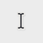
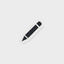
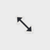
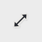

## Offwhite Cursor Pack

Minimal cursors in two variants: **Minimal Offwhite** (off-white fill, charcoal outline) and **Minimal Offwhite Dark** (charcoal fill, off-white outline).

| Cursor | Minimal Offwhite | Minimal Offwhite Dark | Windows file | Linux name |
|---|:-:|:-:|---|---|
| Normal select |  |  | `pointer.cur` | `default` |
| Help select |  |  | `help.cur` | `help` |
| Working in background |  |  | `working.ani` | `progress` |
| Busy |  |  | `busy.ani` | `wait` |
| Precision select |  |  | `precision.cur` | `crosshair` |
| Text select |  |  | `text.cur` | `text` |
| Handwriting |  |  | `handwriting.cur` | `pencil` |
| Unavailable |  |  | `unavailable.cur` | `not-allowed` |
| Vertical resize |  |  | `vert.cur` | `ns-resize` |
| Horizontal resize |  |  | `horz.cur` | `ew-resize` |
| Diagonal resize 1 |  |  | `dgn1.cur` | `nwse-resize` |
| Diagonal resize 2 |  |  | `dgn2.cur` | `nesw-resize` |
| Move |  |  | `move.cur` | `move` |
| Alternate select |  |  | `alternate.cur` | `up-arrow` |
| Link select |  |  | `link.cur` | `pointer` |
| Location select |  |  | `pin.cur` | `pin` |
| Person select |  |  | `person.cur` | `person` |

### Windows 11

Either right-click `install.inf` > **Install** and pick the scheme in Mouse Properties > Pointers, or run
the folder's `apply.ps1` to install and apply it in one step (no admin needed):

```powershell
powershell -ExecutionPolicy Bypass -File ".\Minimal Offwhite Dark\apply.ps1"
```

### Linux (X11 and Wayland)

`linux/` holds both variants as Xcursor themes (`Minimal-Offwhite`, `Minimal-Offwhite-Dark`) in sizes 24, 36 and 48,
with the standard CSS/freedesktop names plus legacy X11 and hash aliases.

```sh
cd linux
./install.sh                        # current user: ~/.local/share/icons
sudo ./install.sh /usr/share/icons  # system-wide, or point it at a package staging dir
```

Then select it in your settings, or set `XCURSOR_THEME=Minimal-Offwhite-Dark` and `XCURSOR_SIZE=24`.
The extra `pin` and `person` cursors have no standard Linux name; they ship as `pin` and `person` for your own use.

### Rebuilding

`Minimal Offwhite` is the source. After changing any of its cursors, regenerate the dark scheme, both Linux themes and the preview images above:

```sh
pip install pillow
python tools/build.py
```
